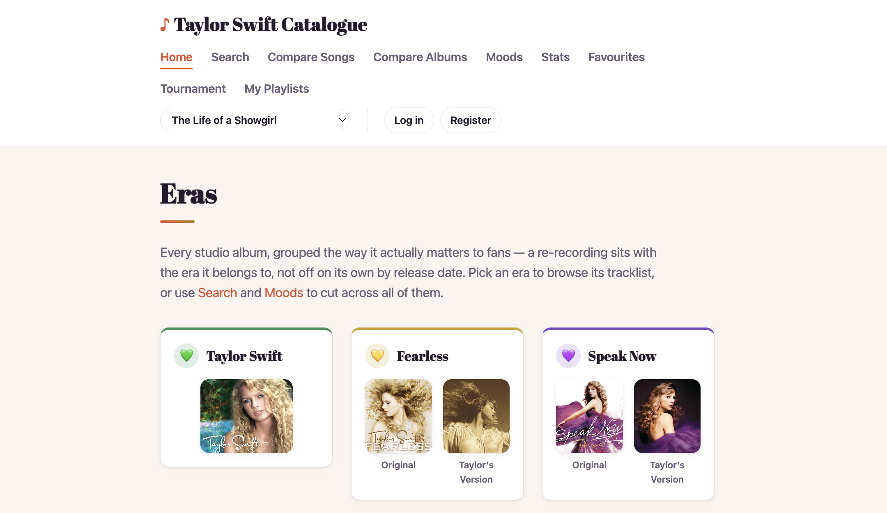
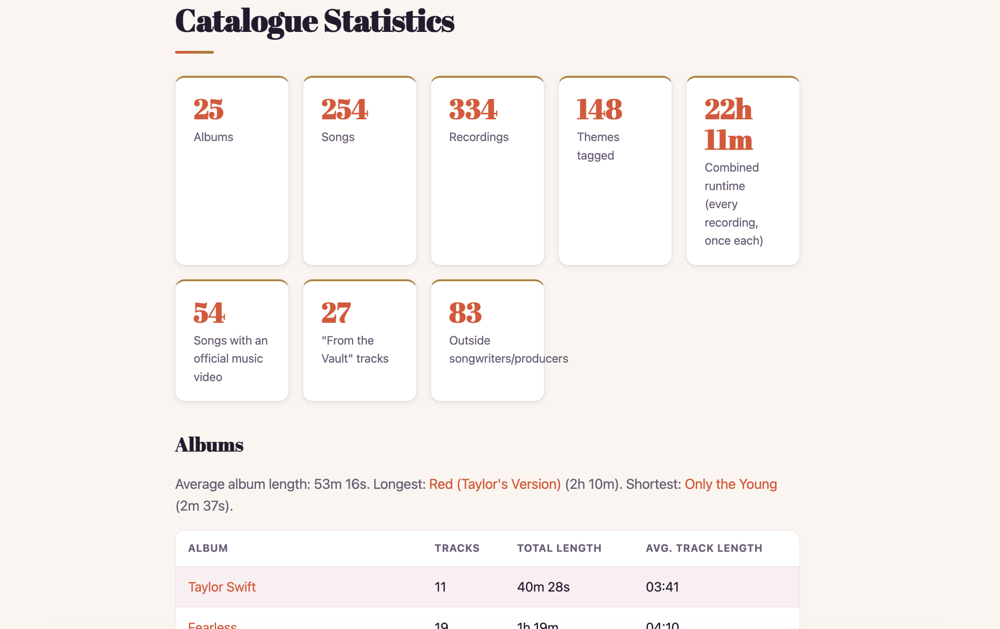
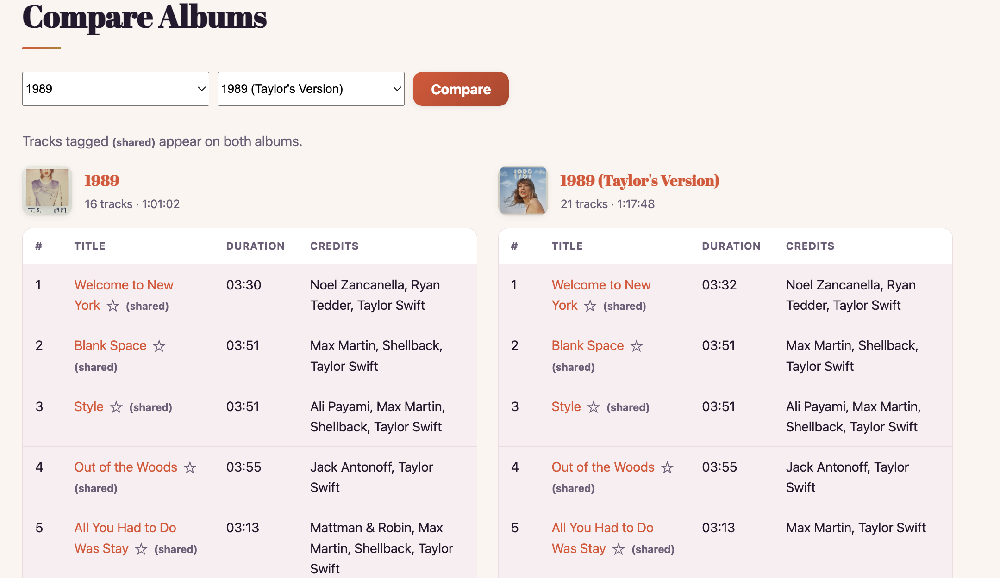
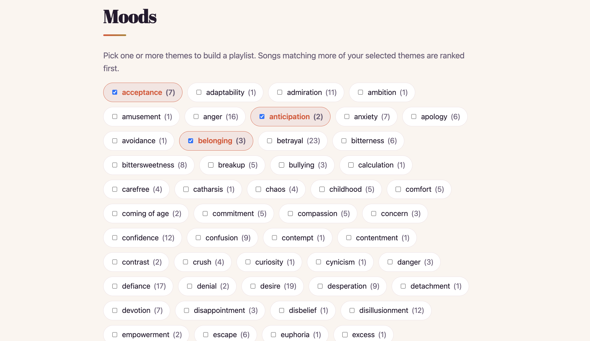
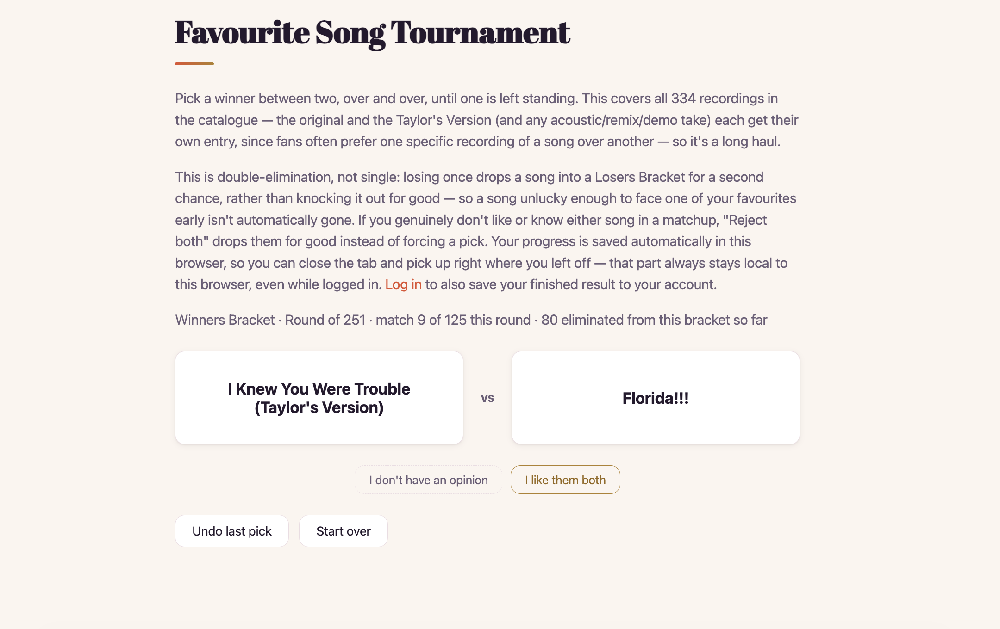
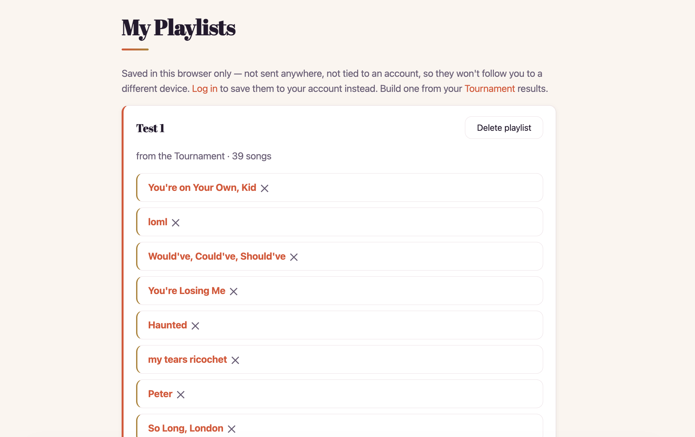

# taylor-swift-db
# Taylor Swift Music Explorer

An unofficial, fan-made full-stack web application for exploring Taylor Swift's music, comparing recordings, discovering songs and organising personal favourites.

## About the Project

This project began as a way to explore and organise Taylor Swift's music catalogue. It has developed into an interactive web application with user accounts, music discovery tools and personalised features.

The application is designed to let users explore the catalogue, compare recordings and create their own collections.

## Features

- **Music catalogue:** Browse albums, songs and different recordings.
- **Song comparison:** Compare different versions of recordings.
- **Search and discovery:** Find songs using keywords, themes and moods.
- **Favourites:** Save favourite songs and albums to a personal account.
- **Playlists:** Create and manage personal playlists.
- **Song tournaments:** Take part in song tournaments and save results.
- **Statistics:** View personal music statistics.
- **User accounts:** Register, log in and access saved information across devices.

## Technologies

- PHP
- MySQL
- JavaScript
- HTML
- CSS
- Git and GitHub

## Screenshots

Screenshots of the application will be added here.

| Homepage | Music Catalogue |
|---|---|
|  |  |

| Song Comparison | Music Discovery |
|---|---|
|  |  |

| Tournament | Personal Playlists |
|---|---|
|  |  |

## Running Locally

The application requires PHP and MySQL.

1. Clone or download this repository.
2. Set up a local MySQL database.
3. Import the database schema and seed files from the `sql` directory in the documented order.
4. Copy `backend/config.example.php` to `backend/config.php`.
5. Update the database connection settings in `backend/config.php`.
6. Start the PHP development server from the `backend` directory:

   ```bash
   php -S localhost:8000
   ```

7. Open `http://localhost:8000` in your browser.

The PHP development server is intended for local development and testing, not production hosting.

## Data Sources and Credits

This is an independent fan project and is not affiliated with, endorsed by or connected to Taylor Swift or her record labels.

Album artwork and music-related information are used for identification and catalogue browsing. YouTube links direct users to relevant videos, including official uploads where available.

All trademarks, music, artwork and other copyrighted materials remain the property of their respective owners.

For further information, see the Data Sources and Privacy pages within the application.

## Disclaimer

This is a non-commercial fan-made project created for educational and portfolio purposes. It is not an official Taylor Swift product.
